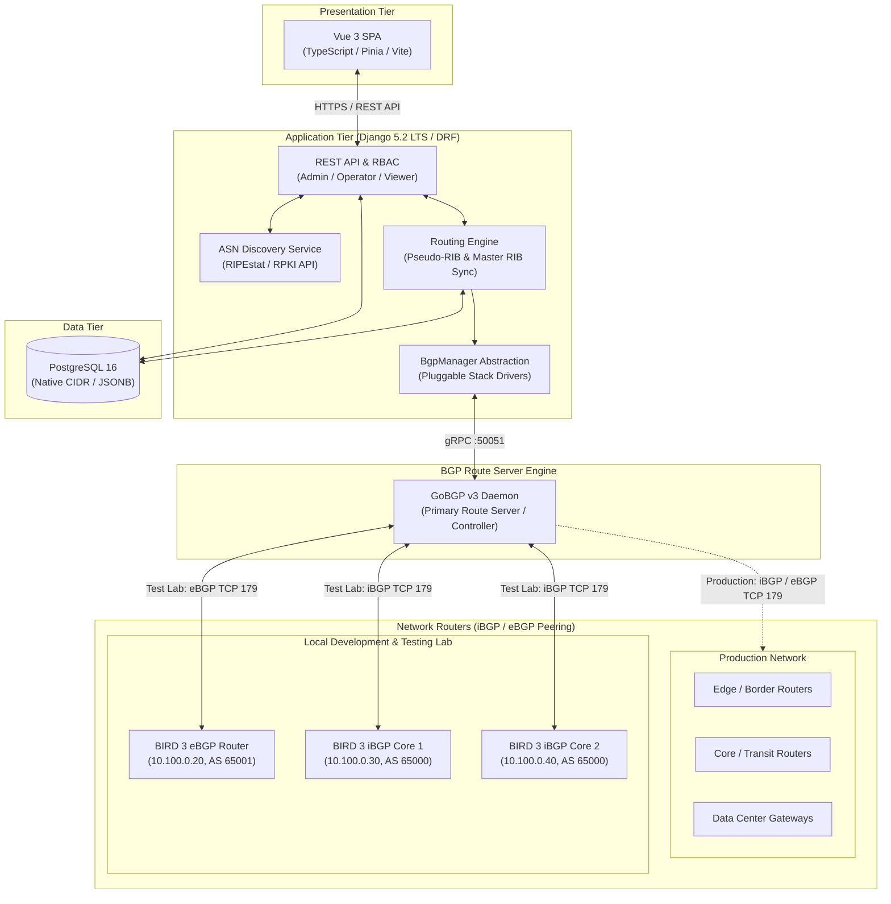

# bgpWebRouteServer — "Gabu"

> **Enterprise-Grade Multi-AFI/SAFI BGP Route Server & Traffic Mitigation Platform**  
> Supporting BGP Flowspec (RFC 5575 / RFC 8955), Remotely Triggered Blackhole (RTBH RFC 7999), IPv4 & IPv6 Unicast Routing, RIPEstat ASN Discovery, and Pluggable BGP Stacks.

---

## Tool Name and Special Dédicace

This tool is named **"Gabu"** in memory of **Frédéric Gabut-Deloraine**.

"Gabu" is the nickname of a brilliant young French network engineer who passed away way too early and is deeply missed by anyone who ever crossed his path. Frédéric was a pioneer in advocating for open, programmable routing protocols and community-driven network security in France.

To enjoy a classic and inspiring presentation given by Frédéric Gabut-Deloraine on leveraging BGP Flowspec for large-scale DDoS mitigation, please watch his FRnOG conference talk:
* **[Frédéric Gabut-Deloraine — FRnOG 18: BGP Flowspec for DDoS Mitigation](http://www.dailymotion.com/video/xtngjg_frnog-18-flowspec-frederic-gabut-deloraine-neo-telecoms_tech)**

This modern implementation carries forward his vision into a production-ready, cloud-native architecture.

---

## Introduction

**bgpWebRouteServer** is developed to help network engineers, internet service providers (ISPs), and data center operators effectively manage undesirable traffic passing through their backbone, transit, and peering links.

The platform provides a modern, intuitive Single Page Application (SPA) backed by a robust REST API to control advanced routing features:
* **Traffic Filtering with BGP Flowspec** (RFC 5575 & RFC 8955 for IPv4 and IPv6).
* **Malicious Traffic Mitigation with BGP Blackholing** (Remotely Triggered Blackhole — RTBH RFC 7999).
* **Unified IP Prefix Asset Inventory** backed by native PostgreSQL `CIDR` indexing.
* **Automated Prefix Discovery** via public RIPEstat and RPKI routing registries.
* **Hierarchical Policy Management** through **Pseudo-RIBs** (Route Profiles) and **Master RIB** reconciliation.
* **Real-Time Loc-RIB Synchronization** and multi-AFI route monitoring across peering partners.

---

## Evolution: From Desktop Prototype to Cloud-Native Platform

This project represents the complete architectural modernization of the original Go + Qt prototype [bgpflowspectool](https://github.com/Pragma-Innovation/bgpflowspectool):

| Feature | Legacy Prototype (`bgpflowspectool`) | Modern Platform (`bgpWebRouteServer`) |
|---|---|---|
| **User Interface** | Go + Qt5 desktop UI (`therecipe/qt`) requiring X11 display | Modern responsive Vue 3 SPA (Vite, Pinia, TypeScript, Tailwind) accessible from any browser |
| **Data Storage** | Local flat JSON `.fslib` files on disk | Relational PostgreSQL 16 with native network data types (`CIDR`, `INET`, `JSONB`) |
| **API Layer** | None (direct in-process gRPC calls) | Comprehensive Django 5.2 LTS REST Framework API with JWT auth and RBAC |
| **AFI/SAFI Scope** | IPv4 Flowspec only | **Multi-AFI/SAFI**: IPv4 Unicast, IPv6 Unicast, IPv4 Flowspec, IPv6 Flowspec |
| **Routing Concept** | Flat, direct rule injection to GoBGP | **Hierarchical Workflow**: Route Assets $\rightarrow$ Pseudo-RIB (Policy) $\rightarrow$ Master RIB $\rightarrow$ Router Loc-RIB |
| **Asset Discovery** | Manual entry only | Automated ASN prefix discovery from RIPEstat / RPKI (IPv4 & IPv6 selective) |
| **BGP Stack Support** | Hardcoded GoBGP local daemon | Pluggable multi-vendor engine (`BaseBgpBackend`) supporting **GoBGP**, **BIRD 3**, **FRR**, and **ExaBGP** |
| **Deployment** | Bare-metal manual build with 8 GB Qt toolchain | Containerized 12-factor architecture with Docker Compose and Kubernetes manifests |

---

## Architecture Overview

`bgpWebRouteServer` is architected as a centralized BGP controller and Route Server:



### Production Deployment vs. Local Test Lab

* **In Production**: GoBGP functions as the centralized BGP Route Server. It establishes BGP sessions using either **eBGP or iBGP** directly with the operator's actual network routers (Cisco, Juniper, Nokia, Arista, etc.) across the backbone, transit edges, and data center perimeters. When an operator triggers a Flowspec filter or an RTBH blackhole, GoBGP advertises the update across these BGP sessions, directing the physical routers to drop or rate-limit traffic at line rate.
* **In the Local Test Lab**: To allow continuous automated testing without requiring physical network hardware, **3 containerized BIRD 3 routers** emulate a realistic multi-peer network:
  * **1x eBGP Edge Peer (`bgpweb-bird`)**: AS 65001 @ `10.100.0.20`
  * **2x iBGP Core Peers (`bgpweb-bird-ibgp1`, `bgpweb-bird-ibgp2`)**: AS 65000 @ `10.100.0.30` and `10.100.0.40`
  * **Resource Efficiency**: BIRD 3 is exceptionally lightweight (written in C), with each container consuming only ~3–4 MB of RAM (total ~11 MB across all 3 routers), having zero impact on developer machines while validating multi-peer eBGP and iBGP distribution simultaneously. The automated integration test suite (`make test-integration`) verifies that Flowspec rules (`t_flow4`) and RTBH routes (`t_unicast4`) propagate and withdraw synchronously across all three peer routers.

### The Hierarchical Routing Model

To prevent accidental route injection and maintain strict operational control over backbone routing tables, `bgpWebRouteServer` implements a three-tier routing hierarchy:

1. **Route Assets (Inventory)**:
   * **IP Prefixes** (`apps.prefixes`): Network subnets discovered via ASN queries or added manually.
   * **Flowspec Rules** (`apps.flowspec`): Granular L3/L4 match criteria (protocol, ports, TCP flags, ICMP) and mitigation actions (`discard`, `rate-limit`, `redirect`, `mark`).
2. **Pseudo-RIBs / Route Profiles** (`apps.routing.PseudoRib`):
   * Reusable policy containers grouping routes that share identical BGP attributes (AFI/SAFI, Next-Hop, standard communities like `65535:666`, extended communities, large communities, local-preference, and MED).
3. **Master RIB** (`apps.routing.Rib`):
   * Groups one or more Pseudo-RIBs representing the cohesive routing table to program into the BGP stack.
   * Pushing the Master RIB evaluates diffs, programs new routes, and automatically withdraws obsolete routes.
4. **Loc-RIB Announcements** (`apps.routing.Announcement`):
   * Live synchronized table showing every route programmed into the router across all AFI/SAFIs with full filtering capabilities.

---

## Key Capabilities

### 1. Unified IPv4 & IPv6 Prefix Inventory
* Native PostgreSQL `CIDR` column type enforcing network subnet boundaries and host-bit zeroing.
* Search by CIDR prefix, label, owner tag, or Autonomous System Number.
* 1-Click RTBH Blackhole action directly from the inventory table.

### 2. Automated ASN Prefix Discovery
* Queries public RIPEstat and RPKI tables to discover all active BGP announced prefixes for any ASN.
* Selective import flags (`import_v4` and `import_v6`).
* High-performance `bulk_create` batching: importing 1,500+ prefixes takes under 1 second.
* Granular CLI command: `python manage.py import_asn_prefixes <ASN> [--no-v4] [--no-v6] [--tag <TAG>]`.

### 3. Comprehensive BGP Flowspec Support (RFC 5575 / RFC 8955)
* Full support for 15 match criteria: destination prefix, source prefix, IP protocol, source/destination ports, ICMP type/code, TCP flags (SYN, ACK, FIN, RST), packet length, and DSCP.
* Actions: Discard (Drop), Rate-Limit (traffic-rate), Policy-Based Routing (Redirect VRF / Next-Hop), and DSCP Remarking.
* Backwards compatible `.fslib` JSON import/export commands (`import_fslib` and `export_fslib`).

### 4. Primary BGP Stack & Multi-Vendor Peering
* **GoBGP (Primary Production BGP Stack)**: GoBGP v3 is the first and primary BGP stack supported to interface with the operator's routers. It provides high-performance gRPC control, robust multi-AFI/SAFI routing tables, and acts as the Route Server establishing iBGP or eBGP peering sessions with the network devices.
* **BIRD 3 (Testing & Lab Emulation)**: BIRD 3 is included in the local environment specifically for testing and CI/CD validation. It simulates a peer router, verifying that advertised Flowspec rules and RTBH blackholes are received and applied as `RTD_BLACKHOLE` in external routing tables.
* **Extensible Driver Architecture**: The application interfaces with the routing daemon through the `BaseBgpBackend` abstraction layer, allowing future direct integration with alternative BGP engines (such as native BIRD, FRRouting, or ExaBGP) without touching frontend or API layers.

### 5. Backbone BGP Session Management & Continuous Reconciliation
* **Unified Single-View Dashboard**: A consolidated, single-table view displaying both database-configured BGP neighbors and live runtime-discovered sessions without disjoint UI tables.
* **Continuous Synchronization**: Automated background reconciliation loop (5-second reactive UI polling and background daemon task `run_peer_syncer`) keeping PostgreSQL intent and GoBGP memory continuously aligned.
* **Explicit Approval Workflow (Option 1)**: Discovered unmanaged peering sessions appear seamlessly alongside managed peers with a distinct `Discovered (Unmanaged)` badge, allowing operators to adopt them into persistent database configuration with 1-click.
* **Filter Tabs & Real-Time Search**: Quick filter tabs (`All Sessions`, `Managed`, `Discovered`, `Established`) with dynamic count badges and search filtering across IP addresses, ASNs, and names.
* **Dual Transport (IPv4 & IPv6)**: Supports IPv4 and IPv6 transport protocols for all peering sessions.
* **Automatic Session Type Inference**: Dynamically identifies internal (`iBGP`) vs. external (`eBGP`) sessions based on the speaker's Local ASN and remote peer ASN.
* **eBGP Multi-Hop Support**: Configurable IP TTL (1–255) for sessions spanning multiple IP hops, firewalls, or loopback interfaces.
* **TCP MD5 Authentication (RFC 2385)**: Optional cryptographic MD5 signature protection on TCP peering sockets.
* **Per-Peer Address Families**: Granular AFI/SAFI negotiation (`ipv4-unicast`, `ipv6-unicast`, `ipv4-flowspec`, `ipv6-flowspec`).
* **Session Lifecycle & Soft Reset (RFC 2918)**: Trigger on-demand soft route refreshes without session drop, alongside real-time FSM state tracking (`ESTABLISHED`, `ACTIVE`, `IDLE`) and prefix exchange telemetry.
* **Interactive Session Inspector**: Clicking any row reveals detailed session metrics: uptime, message counters (Rx/Tx), prefix exchange counters (Recv/Acc/Adv), and transport timers.
* **Persistent Configuration Synchronization**: Automatically writes runtime changes to GoBGP's static configuration (`configs/gobgp.yaml`) to ensure seamless restarts without configuration loss.

---

## Quickstart & Local Lab

### Prerequisites
* [Docker](https://docs.docker.com/get-docker/) & Docker Compose **or** [Podman](https://podman.io/) (with `podman-compose`).
* Python 3.10+ (for local test runner scripts).

### 1. Start the Complete Stack
```bash
git clone https://github.com/Pragma-Innovation/bgpWebRouteServer.git
cd bgpWebRouteServer

# Build and start all 7 containers (DB, Backend, Frontend, GoBGP, 3x BIRD)
make lab-up
```

### 2. Access the Applications
| Service | URL | Default Credentials | Description |
|---|---|---|---|
| **Web UI** | `http://localhost:5173` | `operator` / `operator123` | Single Page Application dashboard |
| **Django API** | `http://localhost:8000/api/v1/` | JWT or Session auth | REST API root |
| **Django Admin** | `http://localhost:8000/admin/` | `admin` / `admin123` | System management & users |
| **GoBGP gRPC** | `localhost:50051` | Open | GoBGP management API |
| **eBGP Peering** | `10.100.0.10` $\leftrightarrow$ `10.100.0.20` | Port 179 | GoBGP (AS 65000) $\leftrightarrow$ BIRD eBGP (AS 65001) |
| **iBGP Peering 1**| `10.100.0.10` $\leftrightarrow$ `10.100.0.30` | Port 179 | GoBGP (AS 65000) $\leftrightarrow$ BIRD iBGP Core 1 (AS 65000) |
| **iBGP Peering 2**| `10.100.0.10` $\leftrightarrow$ `10.100.0.40` | Port 179 | GoBGP (AS 65000) $\leftrightarrow$ BIRD iBGP Core 2 (AS 65000) |

### Role-Based Access Control (RBAC)
The application includes three pre-configured roles:
* **Admin** (`admin` / `admin123`): Full administrative rights, user management, and BGP engine settings.
* **Operator** (`operator` / `operator123`): Create/edit prefixes, manage Flowspec rules, configure Pseudo-RIBs, push Master RIB to GoBGP.
* **Viewer** (`viewer` / `viewer123`): Read-only monitoring of inventory, announcements, and peer states.

---

## Operational Commands (`Makefile`)

The repository includes a comprehensive `Makefile` to streamline development, testing, and operations:

```bash
# Run unit & contract test suite
make test

# Run automated end-to-end eBGP Flowspec & RTBH propagation test
make test-integration

# Check BGP peering session status between GoBGP and BIRD 3
make lab-status

# Inspect routes received in BIRD 3 Unicast and Flowspec tables
make bird-unicast
make bird-routes

# Validate Kubernetes manifests via Kustomize
make k8s-validate

# Tear down the local lab
make lab-down
```

---

## Documentation Index

* **[`SPECS.md`](file:///home/mtexier/projects/bgpWebRouteServer/SPECS.md)**: Exhaustive functional and technical specifications, data models, RFC compliance contracts, and API reference.
* **[`AGENTS.md`](file:///home/mtexier/projects/bgpWebRouteServer/AGENTS.md)**: Development guidelines, coding conventions, architectural invariants, and workflow instructions for AI agents.
* **[`docker-compose.yml`](file:///home/mtexier/projects/bgpWebRouteServer/docker-compose.yml)**: Local container orchestration topology.
* **[`deploy/k8s/`](file:///home/mtexier/projects/bgpWebRouteServer/deploy/k8s/)**: Production-ready Kubernetes manifests with Kustomize overlays (`dev` / `prod`).

---

## Licensing

This project is licensed under the **Apache License, Version 2.0**. See the [LICENSE](file:///home/mtexier/projects/bgpWebRouteServer/LICENSE) file for details.
