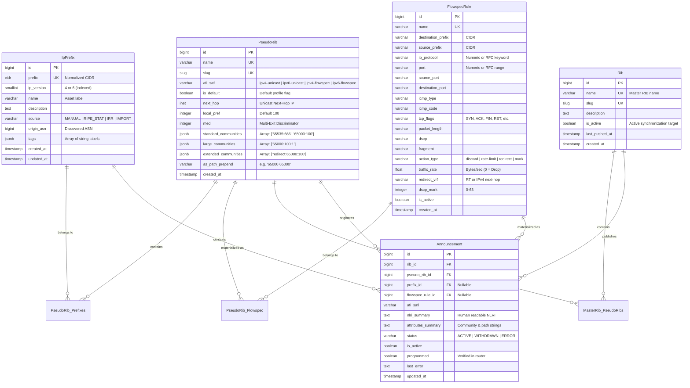
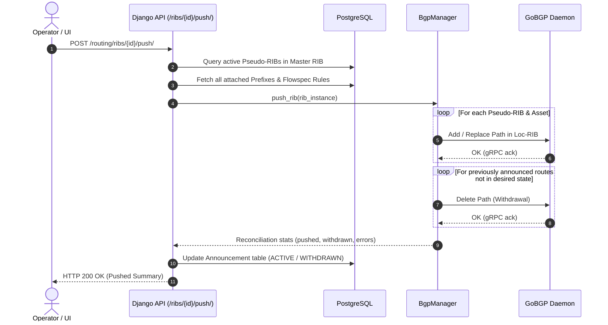

# bgpWebRouteServer — Technical & Functional Specifications

> **Document Version:** 2.0  
> **Status:** Active / Authoritative Reference  
> **Purpose:** Comprehensive functional and technical specification for `bgpWebRouteServer`. Designed to allow any AI agent or software engineer to understand, maintain, or rebuild the entire platform with full feature parity.

---

## Table of Contents
1. [System Overview & Architecture Principles](#1-system-overview--architecture-principles)
2. [Domain Data Models & Entity Relationships](#2-domain-data-models--entity-relationships)
3. [Network Protocol & RFC Specifications](#3-network-protocol--rfc-specifications)
4. [Pluggable BGP Stack Engine Interface](#4-pluggable-bgp-stack-engine-interface)
5. [Core Services & Algorithmic Specifications](#5-core-services--algorithmic-specifications)
6. [REST API Contract & Endpoints](#6-rest-api-contract--endpoints)
7. [Frontend Architecture & State Management](#7-frontend-architecture--state-management)
8. [Automated Verification & Integration Pipeline](#8-automated-verification--integration-pipeline)

---

## 1. System Overview & Architecture Principles

### 1.1 Mission & Scope
`bgpWebRouteServer` is a multi-vendor, multi-AFI/SAFI BGP Route Server and traffic mitigation controller. It coordinates between human operators, telemetry systems, and network backbones to:
1. Maintain an inventory of IPv4 and IPv6 assets.
2. Formulate traffic-filtering rules (BGP Flowspec) and drop rules (BGP Blackholing / RTBH).
3. Bundle policies into reusable **Pseudo-RIBs** (Route Profiles).
4. Aggregate Pseudo-RIBs into a **Master RIB** and push updates atomically to routing stacks (GoBGP, BIRD, FRR, ExaBGP).
5. Expose real-time visibility into what is actively programmed in the router's Loc-RIB.

### 1.2 Architectural Invariants (Non-Negotiables)
1. **Multi-AFI/SAFI Segregation**: The system supports four distinct address families:
   * `ipv4-unicast` (AFI: 1, SAFI: 1)
   * `ipv6-unicast` (AFI: 2, SAFI: 1)
   * `ipv4-flowspec` (AFI: 1, SAFI: 133)
   * `ipv6-flowspec` (AFI: 2, SAFI: 133)
2. **PostgreSQL Native Network Types**: Subnet prefixes MUST be stored using PostgreSQL `CIDR` columns (or validated network strings in development fallback) ensuring subnet host-bit zeroing and mathematical containment queries (`<<=`, `>>=`).
3. **The 3-Tier Routing Hierarchy**:
   $$\text{Route Asset (Prefix / Rule)} \longrightarrow \text{Pseudo-RIB (Policy)} \longrightarrow \text{Master RIB} \longrightarrow \text{Router Loc-RIB}$$
   Direct, unmanaged route injection into the BGP stack without a policy container is prohibited.
4. **Pluggable BGP Backends**: The application tier communicates with routing engines exclusively through the `BaseBgpBackend` abstraction. Code outside `apps/bgp_engine/` must NEVER import vendor-specific SDKs (e.g. GoBGP gRPC or BIRD sockets).

---

## 2. Domain Data Models & Entity Relationships

### 2.1 Entity Relationship Diagram



### 2.2 Model Specifications & Invariants

#### A. `IpPrefix` (`apps.prefixes.models.IpPrefix`)
* **Purpose:** Stores individual IPv4/IPv6 networks owned by the organization or monitored for blackholing.
* **Normalization Logic:**
  ```python
  net = ipaddress.ip_network(prefix, strict=False)
  self.prefix = str(net)            # Clears host bits (e.g. 198.51.100.5/24 -> 198.51.100.0/24)
  self.ip_version = net.version     # 4 or 6 automatically inferred
  ```
* **Ordering:** `['ip_version', 'prefix']`.
* **Database Index:** `ip_version` is indexed to ensure fast sub-millisecond filtering across thousands of prefixes.

#### B. `FlowspecRule` (`apps.flowspec.models.FlowspecRule`)
* **Purpose:** Defines granular packet match patterns and mitigation actions according to RFC 5575 & RFC 8955.
* **Match Invariant:** At least one match field must be specified; a rule cannot be empty.
* **Numeric Range Formatting:** Ports, lengths, protocols, and types must adhere to RFC 5575 comparison operators:
  * Equal: `==80` or `80`
  * Greater/Less: `>=1024`, `<=65535`
  * Range: `>=80&<=443`
  * Negation: `!=22`
* **TCP Flags Bitmask:** Supports names (`SYN`, `ACK`, `FIN`, `RST`, `PSH`, `URG`) and negation (`!SYN`).

#### C. `PseudoRib` (`apps.routing.models.PseudoRib`)
* **Purpose:** A policy group binding NLRIs to a set of BGP path attributes.
* **Type Safety Invariants:**
  1. A `PseudoRib` with `afi_safi='ipv4-unicast'` can ONLY attach `IpPrefix` records where `ip_version=4`.
  2. A `PseudoRib` with `afi_safi='ipv6-unicast'` can ONLY attach `IpPrefix` records where `ip_version=6`.
  3. A `PseudoRib` with `afi_safi='*-flowspec'` can ONLY attach `FlowspecRule` records matching that IP version.
  4. Unicast Pseudo-RIBs must reject `flowspec_rules` attachments; Flowspec Pseudo-RIBs must reject `prefixes` attachments.
* **Community Formats:**
  * Standard: `ASN:VALUE` (e.g. `65535:666`, `65000:100`).
  * Large: `ASN:VALUE1:VALUE2` (e.g. `65000:100:1`).
  * Extended: `target:ASN:VALUE`, `redirect:ASN:VALUE`.

#### D. `Rib` (`apps.routing.models.Rib`)
* **Purpose:** Represents the composite routing table (e.g., `Production Master Loc-RIB`) programmed into the BGP stack.
* **Relationships:** Many-to-many relationship with `PseudoRib`.

#### E. `Announcement` (`apps.routing.models.Announcement`)
* **Purpose:** Audit record and status tracking for every route injected into the physical/daemon Loc-RIB.
* **States:**
  * `ACTIVE`: Successfully injected into GoBGP / BGP daemon.
  * `WITHDRAWN`: Revoked from daemon Loc-RIB.
  * `ERROR`: Injection or withdrawal failed (see `last_error`).

---

## 3. Network Protocol & RFC Specifications

### 3.1 BGP Flowspec (RFC 5575 / RFC 8955)
The platform formats Flowspec NLRIs into standard extended communities:
* **Discard (Drop Traffic):**
  * Extended Community Type: `0x8006` (traffic-rate)
  * Value: `0.0` (rate = 0 bytes/second)
* **Rate-Limit:**
  * Extended Community Type: `0x8006`
  * Value: 32-bit IEEE 754 floating point number representing rate in bytes/sec.
* **Redirect (Policy-Based Routing):**
  * Extended Community Type: `0x8008` (redirect VRF) or IPv4 Next-Hop redirect.
* **DSCP Marking:**
  * Extended Community Type: `0x8009` (traffic-marking)
  * Value: 6-bit DSCP numerical integer (0–63).

### 3.2 Remotely Triggered Blackhole — RTBH (RFC 7999)
* **Standard Community:** `65535:666` (Hex: `0xFFFF029A`).
* **Next-Hop Rewriting:** Set to an RFC 5737 discard address (e.g. `192.0.2.1` for IPv4 or `100::1` for IPv6) or internal null route.
* **Router Verification (BIRD 3):**
  When BIRD receives an update with community `(65535, 666)`, its import filter sets:
  ```text
  dest = RTD_BLACKHOLE;
  accept;
  ```
  Verified via: `birdc show route table t_unicast4 all`.

---

## 4. Pluggable BGP Stack Engine Interface

All BGP engines implement the `BaseBgpBackend` abstract base class located at `apps/bgp_engine/base.py`:

```python
class BaseBgpBackend(ABC):
    @abstractmethod
    def get_server_status(self) -> Dict[str, Any]:
        """Return daemon status, router ID, local ASN, uptime, and memory."""
        pass

    @abstractmethod
    def get_neighbors(self) -> List[Dict[str, Any]]:
        """Return list of BGP peers, state (ESTABLISHED, ACTIVE), and counters."""
        pass

    @abstractmethod
    def add_flowspec_rule(self, rule: FlowspecRule) -> bool:
        """Inject a Flowspec NLRI into the BGP stack."""
        pass

    @abstractmethod
    def delete_flowspec_rule(self, rule: FlowspecRule) -> bool:
        """Withdraw a Flowspec NLRI from the BGP stack."""
        pass

    @abstractmethod
    def add_unicast_route(
        self,
        prefix: str,
        afi_safi: str = "ipv4-unicast",
        next_hop: str = None,
        communities: List[str] = None,
        attributes: Dict[str, Any] = None
    ) -> bool:
        """Inject a Unicast route (e.g. RTBH) with communities and next-hop."""
        pass

    @abstractmethod
    def delete_unicast_route(
        self,
        prefix: str,
        afi_safi: str = "ipv4-unicast",
        next_hop: str = None,
        communities: List[str] = None
    ) -> bool:
        """Withdraw a Unicast route from the BGP stack."""
        pass

    @abstractmethod
    def push_rib(self, rib) -> Dict[str, Any]:
        """Synchronize the complete Master RIB state with the BGP stack."""
        pass
```

### 4.1 GoBGP v3 Reference Implementation (`apps/bgp_engine/backends/gobgp/`)
* **Transport:** gRPC over TCP (default `gobgp:50051`).
* **Protobuf Schema:** `gobgp.proto` v3 (`gobgp_pb2.py` / `gobgp_pb2_grpc.py`).
* **Path Generation:**
  * Unicast: `IPAddressPrefix` wrapped in `Path` with `OriginAttribute`, `NextHopAttribute`, and `CommunitiesAttribute`.
  * Flowspec: `FlowSpecNLRI` containing components (Types 1-13) wrapped in `Path` with `ExtendedCommunitiesAttribute`.

### 4.2 Multi-Stack Providers
* **BIRD Backend (`apps/bgp_engine/backends/bird/driver.py`)**: Interacts with `birdc` UNIX domain socket.
* **FRR Backend (`apps/bgp_engine/backends/frr/driver.py`)**: Interacts with `vtysh` CLI.
* **ExaBGP Backend (`apps/bgp_engine/backends/exabgp/driver.py`)**: Interacts via JSON pipe/HTTP.
* **Mock Backend (`apps/bgp_engine/backends/mock/driver.py`)**: In-memory state store for unit tests and local dev without routing daemons.

---

## 5. Core Services & Algorithmic Specifications

### 5.1 Automated ASN Prefix Discovery (`AsnDiscoveryService`)
Located at `apps/prefixes/services/asn_discovery.py`.

* **External API:** RIPEstat REST endpoint:
  `https://stat.ripe.net/data/announced-prefixes/data.json?resource=AS{asn}`
* **Execution Flow:**
  1. Fetch announced prefix array from RIPEstat via HTTP GET with timeout.
  2. Parse each entry `p`:
     * Validate and normalize via `ipaddress.ip_network(p, strict=False)`.
     * Tally `ipv4_found` vs `ipv6_found`.
     * Filter based on caller flags (`import_v4` and `import_v6`).
     * Deduplicate within memory set `seen_prefixes`.
  3. **High-Performance Bulk Ingestion:**
     ```python
     before_v4 = IpPrefix.objects.filter(ip_version=4).count()
     before_v6 = IpPrefix.objects.filter(ip_version=6).count()

     # Execute in chunks of 1,000 using native PostgreSQL ON CONFLICT DO NOTHING
     for i in range(0, len(to_create), 1000):
         IpPrefix.objects.bulk_create(to_create[i:i + 1000], ignore_conflicts=True)

     after_v4 = IpPrefix.objects.filter(ip_version=4).count()
     after_v6 = IpPrefix.objects.filter(ip_version=6).count()
     ```
  4. Return detailed audit statistics:
     ```json
     {
       "asn": 15169,
       "total_found": 1423,
       "ipv4_found": 1247,
       "ipv6_found": 176,
       "created": 1247,
       "ipv4_created": 1247,
       "ipv6_created": 0,
       "skipped_or_existing": 176
     }
     ```

### 5.2 Master RIB Push & Reconciliation Algorithm
Located at `apps/routing/views.py` (`RibViewSet.push`).



---

## 6. REST API Contract & Endpoints

All API endpoints are prefixed with `/api/v1/` and return `application/json`.

### 6.1 Authentication & RBAC
* **Authentication:** JWT Bearer tokens (`/api/v1/auth/token/`) or Django session cookies.
* **Roles:**
  * `Viewer`: GET, HEAD, OPTIONS on all endpoints.
  * `Operator`: Full CRUD on prefixes, flowspec rules, pseudo-ribs, ribs, and push actions.
  * `Admin`: Full permissions including user management and system settings.

### 6.2 Endpoint Reference Matrix

| Method | Endpoint | Description | Query Parameters / Body | RBAC Role |
|---|---|---|---|---|
| `GET` | `/prefixes/` | List prefix inventory | `?ip_version=4\|6`, `?search=`, `?asn=`, `?page=`, `?page_size=` | Viewer |
| `POST` | `/prefixes/` | Add prefix manually | `{"prefix": "198.51.100.0/24", "name": "VIPs"}` | Operator |
| `DELETE`| `/prefixes/{id}/` | Remove prefix | None | Operator |
| `POST` | `/prefixes/import-asn/` | Auto-discover via ASN | `{"asn": 15169, "tag": "prod", "import_v4": true, "import_v6": true}` | Operator |
| `GET` | `/flowspec/rules/` | List Flowspec rules | `?search=`, `?is_active=`, `?page=` | Viewer |
| `POST` | `/flowspec/rules/` | Create Flowspec rule | Full L3/L4 match criteria & action payload | Operator |
| `POST` | `/flowspec/rules/{id}/toggle/` | Quick toggle rule | None | Operator |
| `DELETE`| `/flowspec/rules/{id}/` | Delete rule | None | Operator |
| `GET` | `/routing/pseudo-ribs/` | List Pseudo-RIB profiles| `?afi_safi=`, `?search=` | Viewer |
| `POST` | `/routing/pseudo-ribs/` | Create Pseudo-RIB | `{"name": "RTBH", "afi_safi": "ipv4-unicast", "standard_communities": ["65535:666"]}` | Operator |
| `POST` | `/routing/pseudo-ribs/{id}/add-prefix/` | Attach prefix | `{"prefix_id": 123}` | Operator |
| `POST` | `/routing/pseudo-ribs/{id}/remove-prefix/` | Detach prefix | `{"prefix_id": 123}` | Operator |
| `POST` | `/routing/pseudo-ribs/{id}/add-flowspec/` | Attach rule | `{"rule_id": 456}` | Operator |
| `POST` | `/routing/pseudo-ribs/{id}/remove-flowspec/` | Detach rule | `{"rule_id": 456}` | Operator |
| `GET` | `/routing/ribs/` | List Master RIBs | None | Viewer |
| `POST` | `/routing/ribs/{id}/push/` | Push Master RIB to BGP | None | Operator |
| `GET` | `/routing/announcements/` | Loc-RIB announcements | `?afi_safi=`, `?pseudo_rib=`, `?status=`, `?search=` | Viewer |
| `GET` | `/peers/` | List BGP neighbors | None | Viewer |
| `GET` | `/bgp/status/` | Live daemon status | None | Viewer |

---

## 7. Frontend Architecture & State Management

Built with **Vue 3**, **Vite**, **Pinia**, and **TypeScript**.

### 7.1 Pinia Store Directory
* **`prefixStore.ts`**: Manages `prefixes`, `totalCount`, `currentPage`, `pageSize`, `importFromAsn()`, `createPrefix()`, and `deletePrefix()`.
* **`routingStore.ts`**: Manages `ribs`, `pseudoRibs`, `announcements`, `pushRibToBgp()`, `addPrefixToPseudoRib()`, and `triggerQuickBlackhole()`.
* **`flowspecStore.ts`**: Manages Flowspec CRUD, active rule toggles, and modal states.
* **`peersStore.ts`**: Streams BGP neighbor states, FSM statuses, and prefix counters.
* **`authStore.ts`**: Manages JWT lifecycle, user roles (`canEdit`), and session expiration.

### 7.2 UI Views
* **`PrefixInventoryView.vue`**: Unified table for IPv4 and IPv6 assets. Features server-side pagination, instant family filtering (`ALL`, `IPv4 Only`, `IPv6 Only`), 1-click RTBH modal, and RIPEstat ASN import dialog with dual v4/v6 checkboxes.
* **`FlowspecView.vue`**: Rule management table, RFC action chips, and interactive `RuleBuilderModal.vue`.
* **`RoutingWorkflowView.vue`**: Master orchestration view managing the creation of Pseudo-RIBs, asset assignment, Master RIB grouping, and the "Push to GoBGP" command.
* **`AnnouncementsView.vue`**: Live Loc-RIB table displaying all routes programmed into the router with multi-AFI filters.
* **`PeersView.vue`**: Visual peer cards showing BGP state (Established, Active, Idle), remote ASN, and prefix counters.

---

## 8. Automated Verification & Integration Pipeline

The repository provides automated test suites ensuring zero regressions across protocols and services.

### 8.1 Backend Unit & Contract Tests (`make test`)
* **Prefix Model Tests**: Validates CIDR formatting, host bit normalization, and IPv4 vs IPv6 inference.
* **ASN Discovery Tests**: Validates selective `import_v4` and `import_v6` parsing against mocked RIPEstat payloads.
* **API Permission Tests**: Enforces RBAC permissions across all endpoints.
* **Flowspec Validation Tests**: Ensures invalid L3/L4 match criteria are rejected with HTTP 400.

### 8.2 End-to-End eBGP Integration Test (`make test-integration`)
Executes `tests/integration/test_ebgp_flowspec_propagation.py` against live containers:

1. **Verify Session**: Confirms GoBGP (10.100.0.10) $\leftrightarrow$ BIRD 3 (10.100.0.20) is `Established`.
2. **Authenticate**: Obtains JWT token for user `operator`.
3. **Create Assets**: Injects `198.51.100.77/32` (Prefix) and `198.51.100.222/32 port 22 -> Drop` (Flowspec).
4. **Attach to Policy**: Associates Prefix with RTBH Pseudo-RIB (`65535:666`, Next-Hop: `192.0.2.1`) and Flowspec with Edge Pseudo-RIB.
5. **Push Master RIB**: Triggers push to GoBGP.
6. **Verify GoBGP Loc-RIB**: Verifies both NLRIs are present via `gobgp` CLI.
7. **Verify BIRD 3 Route Tables**:
   * Inspects `t_unicast4`: Verifies `198.51.100.77/32` is installed as `RTD_BLACKHOLE`.
   * Inspects `t_flow4`: Verifies Flowspec rule is active with discard extended community.
8. **Withdrawal**: Detaches assets and triggers push reconciliation.
9. **Verify Route Purge**: Confirms routes are cleanly purged from BIRD 3 routing tables.
